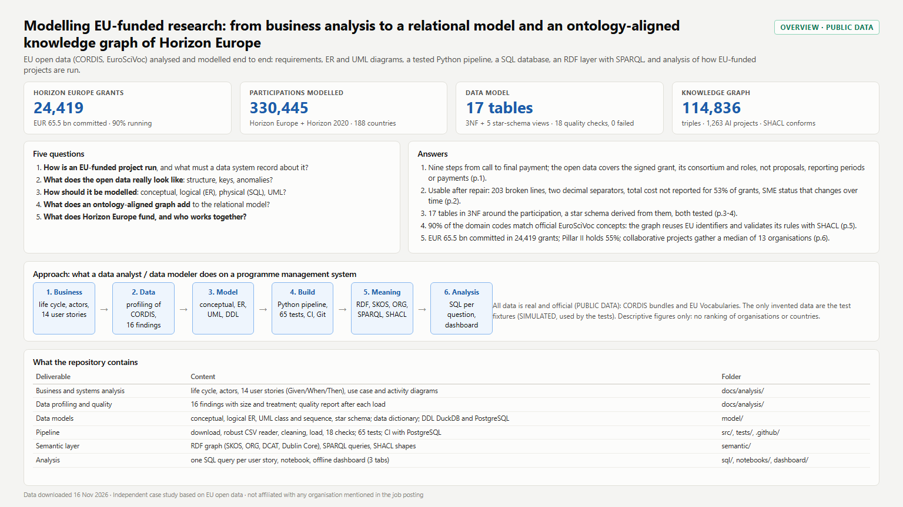
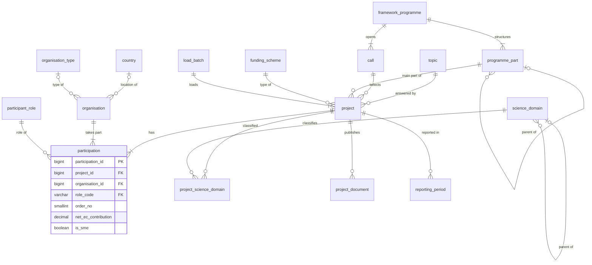

# Modelling EU-funded research: from business analysis to a relational model and an ontology-aligned knowledge graph of Horizon Europe

EU open data (CORDIS, EuroSciVoc) analysed and modelled end to end: requirements, ER and UML diagrams, a tested Python
pipeline, a SQL database, an RDF layer with SPARQL, and analysis of how EU-funded projects are run.

[](../../actions/workflows/ci.yml) · **PUBLIC DATA** (CORDIS and EU Vocabularies) ·
the only invented rows are the test fixtures, labelled **SIMULATED**.

- **Report (8 pages):** [docs/EU_Funded_Research_Data_Model_Case_Study.pdf](docs/EU_Funded_Research_Data_Model_Case_Study.pdf)
- **Dashboard:** [Horizon Europe explorer](https://albt-france.github.io/eu-funded-research-data-model-case-study/dashboard/horizon_europe_explorer.html)
  (opens in the browser; tabs: overview, scientific domains, cooperation)



## Four results

| | Result | Where |
|---|---|---|
| 1 | **24,419 Horizon Europe grants, EUR 65.5 bn of maximum EU contribution** (data of 16 Nov 2026), 90% still running. Pillar II *Global Challenges and European Industrial Competitiveness* holds 55%. EU-27 organisations receive 88% of the funding. | `sql/us01`, `us02` |
| 2 | **Two kinds of grants:** 47% have a single beneficiary (ERC, MSCA, EIC); collaborative research and innovation actions gather a median of 13 organisations from 8 countries. Coordination rates must be read with this mix in mind. | `sql/us05`, `us09` |
| 3 | **The open data needs a model, not just a load:** 203 lines that strict CSV parsers reject, two decimal separators, a total cost not reported for 53% of grants (lump sums), and an SME status that changes over time for 340 organisations, so it is stored per participation. 18 checks after each load, 0 failed. | [DATA_PROFILING.md](docs/analysis/DATA_PROFILING.md) |
| 4 | **90% of CORDIS domain codes (956 of 1,059) match official EuroSciVoc concepts exactly**: the last segment of the CORDIS code is the official notation. The graph (114,836 triples) reuses EU Vocabularies URIs and passes SHACL validation. | [MAPPING.md](semantic/MAPPING.md) |

## The model

17 tables in third normal form, built around the participation of an organisation in a project; a star schema derived as
views for reporting. Same DDL on DuckDB (default) and PostgreSQL (applied to PostgreSQL 16 in CI).



All diagrams (use case, activity, conceptual, logical ER, UML class, UML sequence, star schema): [model/DIAGRAMS.md](model/DIAGRAMS.md).

## How to rerun

Python 3.10+. Raw files are not in the repository; the scripts download them (about 90 MB, one request per file).

```bash
python -m venv .venv && .venv/Scripts/activate        # Linux/macOS: source .venv/bin/activate
pip install -r requirements.txt
python src/download.py --h2020     # CORDIS bundles (Horizon Europe, and Horizon 2020 for the comparison) -> data/raw/
python src/sparql_endpoint.py      # EU Vocabularies extracts (already versioned in data/reference/; --refresh to update)
python src/load.py                 # stage, clean, load DuckDB (data/cordis.duckdb), quality checks (about 40 s)
pytest                             # 65 tests, on SIMULATED fixtures: no download needed
python src/build_rdf.py            # RDF graph, 10 SPARQL queries, SHACL validation
python src/analysis.py             # one SQL query per user story -> data/processed/
python src/profile_data.py         # docs/analysis/DATA_PROFILING.md
python src/build_dictionary.py     # model/DATA_DICTIONARY.md
python src/build_notebook.py       # notebooks/analysis.ipynb (executed)
python src/build_dashboard.py      # dashboard/horizon_europe_explorer.html
python src/build_diagrams.py       # SVG/PNG of the Mermaid diagrams (needs mermaid-cli, see the script header)
python src/build_pdf.py            # docs/EU_Funded_Research_Data_Model_Case_Study.pdf (needs Microsoft Edge)
```

PostgreSQL: apply `model/ddl/schema.sql`, then `schema_postgres.sql`, then `mart.sql` (see `.github/workflows/ci.yml`).

## Repository

| Folder | Content |
|---|---|
| `docs/analysis/` | business context, requirements, data profiling, quality report |
| `model/` | diagrams (Mermaid sources and images), DDL, model notes, data dictionary |
| `src/` | download, robust CSV reader, staging, cleaning, load, quality checks, RDF, analysis, report builders |
| `tests/` | unit, schema, end-to-end and semantic tests; SIMULATED fixtures in CORDIS format |
| `sql/` | one query per user story |
| `semantic/` | vocabulary, SHACL shapes, sample graph, SPARQL queries and results |
| `data/reference/`, `data/processed/` | EU Vocabularies extracts (dated); small analysis outputs |
| `dashboard/`, `notebooks/`, `docs/` | dashboard, notebook, PDF report and page images |

## Methods

Business analysis first (life cycle of a grant from Regulation (EU) 2021/695 and the Funding & Tenders Portal manual,
user stories), then profiling of the files, then the model (conceptual, logical, physical), then the pipeline and the
semantic layer, then the analysis. Every figure in the report is read from a pipeline output.

AI-assisted workflow: I used Claude, mainly to write scripts faster. I drove the project: I defined the questions, chose and validated the data sources, made the analytical decisions and checked every result.

## Sources and licences

| Source | Use | Licence |
|---|---|---|
| [CORDIS - EU research projects under Horizon Europe](https://cordis.europa.eu/data/cordis-HORIZONprojects-csv.zip), Publications Office of the EU (downloaded 16 Nov 2026) | projects, organisations, roles, domains, legal basis | reuse with acknowledgement, [Commission Decision 2011/833/EU](http://data.europa.eu/eli/dec/2011/833/oj) |
| [CORDIS - Horizon 2020 projects](https://cordis.europa.eu/data/cordis-h2020projects-csv.zip) | comparison | same |
| EU Vocabularies via the [Publications Office SPARQL endpoint](https://publications.europa.eu/webapi/rdf/sparql) (17 Nov 2026): EuroSciVoc, country authority table | reference data, alignment | Commission reuse policy, CC BY 4.0 |
| [Regulation (EU) 2021/695](https://eur-lex.europa.eu/eli/reg/2021/695/oj); Funding & Tenders Portal Online Manual | life cycle and rules (summarised) | EUR-Lex |

## Limits

- Amounts are **maximum EU contributions** in signed grants (commitments), not payments; 90% of Horizon Europe grants are
  still running. Reporting periods, payments and proposals are not published: `reporting_period` is modelled and empty.
- CORDIS is the authoritative source: inconsistencies are reported by the quality checks, not corrected
  (e.g. 325 projects whose participants' amounts do not add up to the grant).
- 18% of Horizon Europe projects have no scientific domain; 103 CORDIS domain codes are not in the published EuroSciVoc.
- Possible duplicate organisations (same name and country, different PIC) are flagged, not merged.
- Descriptive figures only: no judgement on organisations or countries. Funding and coordination by country depend on
  grant types and association rules, not analysed here.

## Data protection

No personal data: address, post code, VAT number, coordinates and contact-form links are dropped at ingestion (tested).
In the graph, only universities, research organisations and public bodies are named; other organisations appear by PIC.

---
Independent case study based on EU open data · not affiliated with any organisation mentioned in the job posting.
