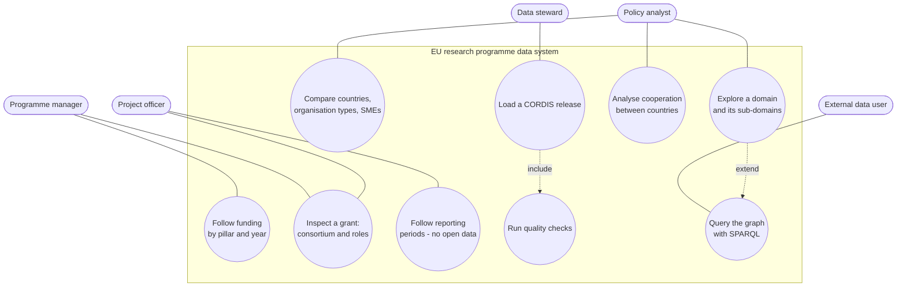
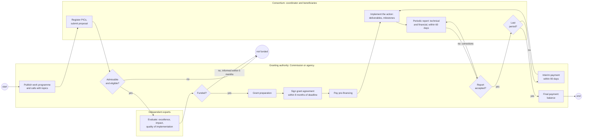
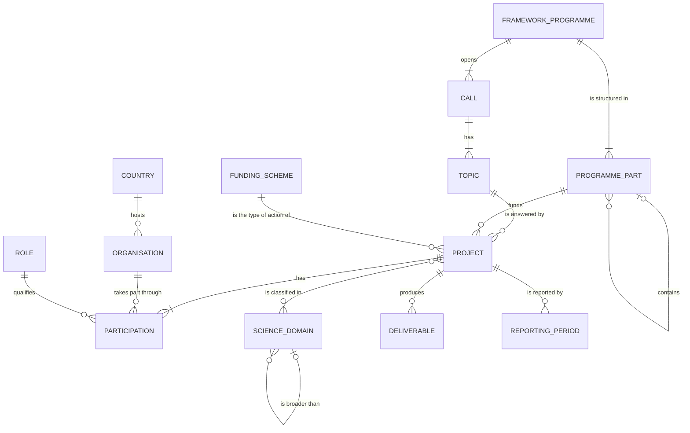
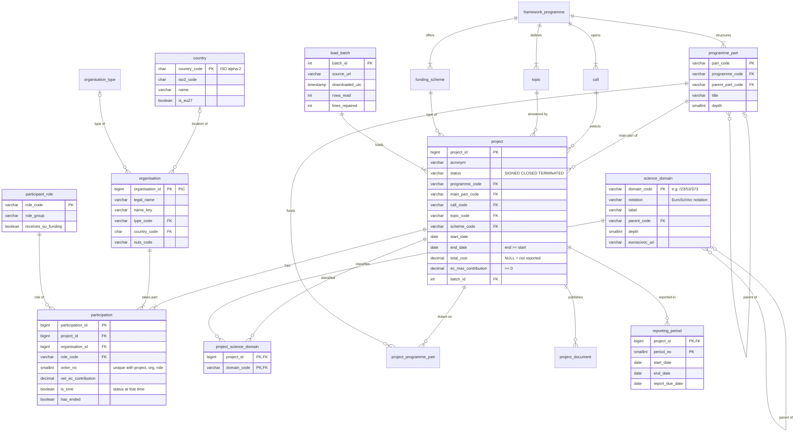
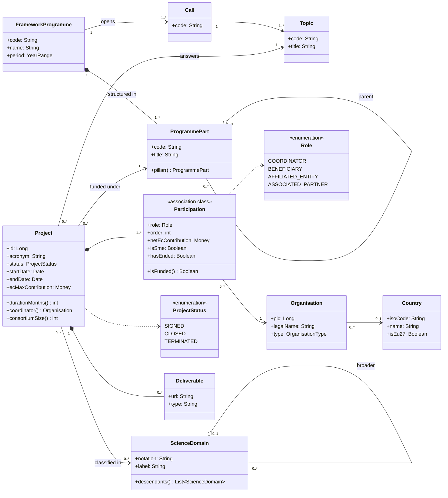
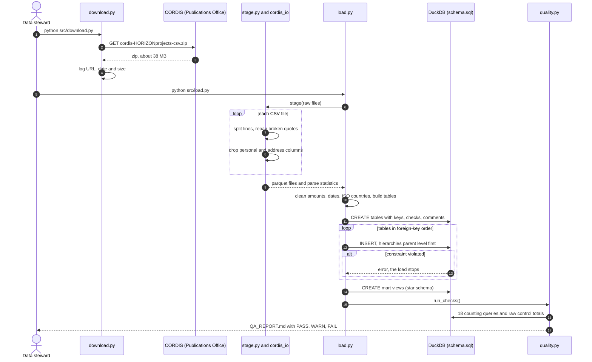
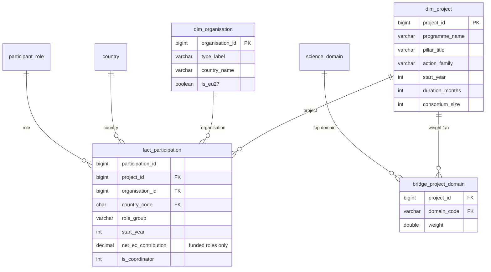

# Diagrams

Diagrams as code: the `.mmd` files are the source; GitHub renders the blocks below; `python src/build_diagrams.py` renders SVG and PNG for the report.

## Use case diagram (UML)

Source: [`diagrams/01_use_cases.mmd`](diagrams/01_use_cases.mmd) · image: [`01_use_cases.svg`](diagrams/01_use_cases.svg)

## Activity diagram: life cycle of a grant (UML)

Source: [`diagrams/02_activity_lifecycle.mmd`](diagrams/02_activity_lifecycle.mmd) · image: [`02_activity_lifecycle.svg`](diagrams/02_activity_lifecycle.svg)

## Conceptual model

Source: [`diagrams/03_conceptual.mmd`](diagrams/03_conceptual.mmd) · image: [`03_conceptual.svg`](diagrams/03_conceptual.svg)

## Logical model: entity-relationship diagram

Source: [`diagrams/04_logical_er.mmd`](diagrams/04_logical_er.mmd) · image: [`04_logical_er.svg`](diagrams/04_logical_er.svg)

## Class diagram (UML)

Source: [`diagrams/05_class_uml.mmd`](diagrams/05_class_uml.mmd) · image: [`05_class_uml.svg`](diagrams/05_class_uml.svg)

## Sequence diagram: loading a CORDIS release (UML)

Source: [`diagrams/06_sequence_load.mmd`](diagrams/06_sequence_load.mmd) · image: [`06_sequence_load.svg`](diagrams/06_sequence_load.svg)

## Analytical variant: star schema

Source: [`diagrams/07_star_schema.mmd`](diagrams/07_star_schema.mmd) · image: [`07_star_schema.svg`](diagrams/07_star_schema.svg)

