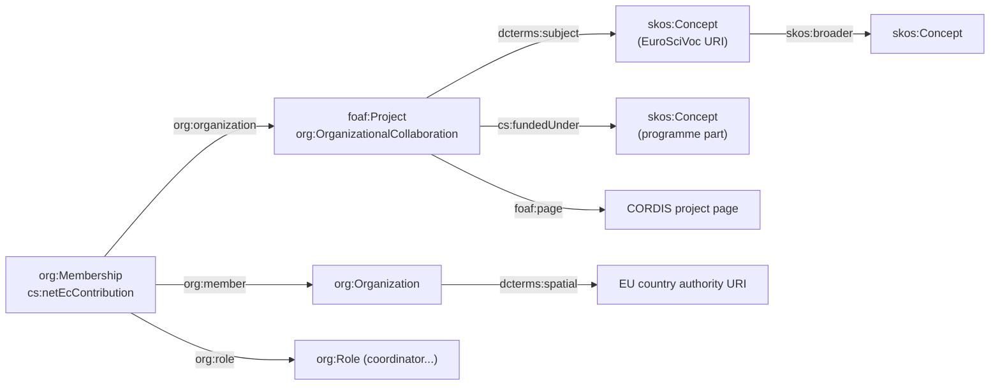

# Semantic layer: from the relational model to an ontology-aligned graph

**PUBLIC DATA.** Built by `src/build_rdf.py` from the DuckDB database, for a sample: the 1,263 Horizon Europe projects
classified under *artificial intelligence* or any of its sub-domains in EuroSciVoc.
Output: [`graph/horizon_ai_sample.ttl`](graph/horizon_ai_sample.ttl) (114,836 triples, Turtle).

## Principle: reuse, do not invent

Every table and column is mapped to a term of an existing W3C or EU vocabulary. Only five local terms remain
([`vocabulary.ttl`](vocabulary.ttl)), each attached to a standard super-property, for what no standard covers
(euro amounts, the SME flag of a participation, the funding scheme, the legal basis).

| Relational model | RDF | Vocabulary |
|---|---|---|
| `project` | `foaf:Project` and `org:OrganizationalCollaboration` ("a collaboration between organizations, such as a project") | FOAF, W3C ORG |
| `project.title`, `acronym`, `project_id` | `dcterms:title`, `skos:altLabel`, `dcterms:identifier` | Dublin Core, SKOS |
| `project.start_date`, `end_date` | `dcterms:temporal` → `dcterms:PeriodOfTime` with `dcat:startDate`, `dcat:endDate` | DCAT |
| CORDIS project page | `foaf:page` → `https://cordis.europa.eu/project/id/{id}` | FOAF |
| `project.ec_max_contribution` | `cs:ecMaxContribution` (`xsd:decimal`) | local |
| `project.main_part_code` → `programme_part` | `cs:fundedUnder` (sub-property of `dcterms:relation`) → `skos:Concept` with `skos:broader` | local, SKOS |
| `project_science_domain` | `dcterms:subject` → EuroSciVoc concept | Dublin Core |
| `science_domain` | `skos:Concept`, `skos:prefLabel`, `skos:broader`, `skos:inScheme`, `skos:notation`; **official EuroSciVoc URI** when the notation exists in EU Vocabularies, local URI otherwise | SKOS, EU Vocabularies |
| `organisation` | `org:Organization`, `org:identifier` (PIC), `org:classification` → organisation type concept | W3C ORG |
| `organisation.country_code` | `dcterms:spatial` → **EU country authority URI** (e.g. `.../authority/country/GRC`) | Dublin Core, EU Vocabularies |
| `participation` (organisation × project × role × amount) | `org:Membership` with `org:member`, `org:organization`, `org:role`, `cs:netEcContribution`, `cs:isSme` | W3C ORG |
| `participant_role` | `org:Role` (a `skos:Concept`), with `skos:broader` to the four role groups | W3C ORG, SKOS |
| the graph itself | `dcat:Dataset` with `dcterms:source`, `dcterms:license`, `dcterms:issued`, `prov:wasDerivedFrom` | DCAT, PROV |

The participation is an n-ary relation (organisation, project, role, amount): in RDF it becomes a node of its own
(`org:Membership`), exactly as it is a table of its own in the relational model.

## Queries

- **Ten SPARQL queries on the graph** (`queries/graph_*.rq`, results in `results/graph_*.csv`): domain and all its
  sub-domains (`skos:broader*`), funding by country, country pairs, coordinators by organisation type, broad consortia,
  co-occurring domains, CORDIS-only concepts and their nearest official concept, ongoing projects, SME share by
  programme part, and an `ASK` that must answer `false` (no project without a coordinator).
- **Three queries on the real Publications Office endpoint** (`queries/endpoint_*.rq`, run by `src/sparql_endpoint.py`):
  EuroSciVoc top concepts with their number of descendants, one concept in six languages, the path of *machine learning*
  up to *natural sciences*. The same endpoint gives the reference extracts the pipeline uses (EuroSciVoc concepts,
  country authority table).

## Validation (SHACL)

[`shapes.ttl`](shapes.ttl) writes the business rules of the relational model for the graph: one identifier and one
title per project, typed dates and amounts, amounts ≥ 0, **exactly one coordinator per project** (qualified value shape
on the inverse of `org:organization`), countries taken from the EU authority table, one English label per concept.
`pyshacl` validates the sample (`results/shacl_report.txt`: conforms). A test removes the coordinators and checks that
validation fails. The first version of the mapping failed one shape: the role concept *coordinator* had two English
labels because its role group has the same name. SHACL found it; the groups now have their own URIs.

## What the semantic layer adds to the relational model

1. **Hierarchies are queried, not hard-coded.** "Projects in AI and all its sub-domains" is one property path
   (`skos:broader*`), whatever the depth; in SQL it needs a recursive query written for this tree.
2. **Shared identifiers.** Domains and countries use the official EU Vocabularies URIs. 956 of the 1,059 domain codes
   used by CORDIS (90%) match an official EuroSciVoc concept exactly: the last segment of the CORDIS code is the
   official notation. Any other EU dataset that uses the same URIs can be joined without a mapping table.
3. **Multilingual labels for free.** The official concept carries its labels in six languages (endpoint query 2).
4. **Self-describing data.** The graph carries its own source, licence and date (DCAT, PROV), and its rules (SHACL).

## Limits

- The base IRI `https://example.org/cordis/` is a placeholder: a publisher would mint IRIs in a namespace it owns.
- 103 CORDIS domain codes are deeper levels that do not exist in the published EuroSciVoc; they get local URIs, linked
  to their official parent with `skos:broader`, so a query on the parent still finds them.
- The graph is a sample built from the database: the relational model stays the system of record for loads, constraints
  and aggregates over 330,000 participations, where SQL is simpler and faster.
- Amounts are commitments (maximum grant), not payments, as in the relational model.
